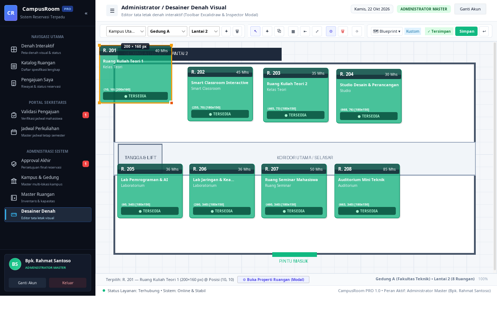

# CampusRoom

Aplikasi desktop manajemen pemesanan dan pemetaan ruangan kampus berbasis Java Swing dan SQLite, dirancang untuk memudahkan pengecekan ruangan kosong, penjadwalan kelas pengganti, dan validasi berjenjang.

---

## Editor Denah Visual

Fitur editor denah interaktif dengan Ribbon Toolbar untuk mengatur posisi, ukuran, penambahan ruangan, serta custom blueprint lantai gedung:



---

## Fitur Utama

- **Denah Visual Interaktif**: Visualisasi denah multi-gedung dan multi-lantai dengan indikator status ketersediaan realtime (Hijau: Kosong, Merah: Terpakai).
- **Editor Layout Denah**: Ribbon toolbar untuk drag-and-drop ruangan, penyesuaian dimensi koordinat (X, Y, W, H), auto grid, serta upload denah blueprint gedung.
- **Deteksi Bentrok Jadwal**: Pengecekan otomatis ketersediaan ruangan terhadap jadwal perkuliahan tetap dan reservasi aktif berdasarkan tanggal dan slot waktu.
- **Alur Validasi Bertingkat**:
  - Mahasiswa (PJ): Cek denah dan mengajukan peminjaman ruangan.
  - Sekretaris Dekan: Input jadwal reguler dan validasi permohonan.
  - Admin: Approval akhir pemesanan serta manajemen data master dan denah.

---

## Konsep OOP yang Diterapkan

- **Class & Object**: Pemodelan entitas `Campus`, `Building`, `Room`, `User`, `RegularSchedule`, dan `Booking`.
- **Encapsulation**: Properti private/protected dengan getter/setter tervalidasi.
- **Inheritance & Abstraction**: Superclass abstract `User` (diturunkan ke `StudentUser`, `SecretaryUser`, `AdminUser`) dan `BaseEntity`.
- **Polymorphism**: Method overriding pada model user (`getRoleDisplayName`, hak akses persetujuan) dan dynamic DAO mapping.
- **Constructor Overloading**: Konstruktor fleksibel untuk inisialisasi baru maupun mapping database.

---

## Akun Demo

| Role | Username | Password | Deskripsi |
|---|---|---|---|
| Mahasiswa (PJ) | `mahasiswa` | `123` | Muhamad Nur Akbar (Cek ketersediaan & ajukan booking) |
| Sekretaris Dekan | `sekdek` | `123` | Ibu Nurul Hidayah, S.Kom. (Kelola jadwal & validasi berkas) |
| Admin Master | `admin` | `123` | Bpk. Rahmat Santoso (Approval akhir & kelola denah/master data) |

---

## Cara Menjalankan

### Opsi 1: Terminal / Bash
```bash
./run.sh
```

### Opsi 2: Apache NetBeans
Buka proyek melalui menu **File > Open Project**, pilih folder `campusroom_app`, lalu tekan **F6** (Run).

### Opsi 3: Maven CLI
```bash
mvn compile exec:java
```
