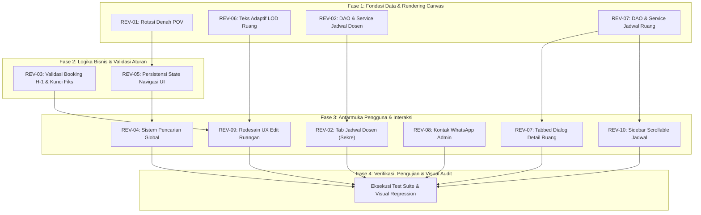

# Panduan Eksekusi Teknis AI Agent (Implementation Execution Guide)

> **Dokumen Operasional**: Panduan Langkah-demi-Langkah untuk AI Engineering Agent  
> **Target Proyek**: `campusroom_app` (Java Swing / SQLite / Maven)  
> **Aturan Utama**: Setiap tahap harus mempertahankan kompatibilitas penuh dengan kode eksisting dan seluruh pengujian otomatis (`mvn test`) wajib lulus (*green build*).

---

## 🗺️ 1. Peta Ketergantungan Modul (Dependency Graph)

Implementasi 10 butir revisi dianjurkan untuk dieksekusi secara bertahap dalam **4 Fase Berurutan** guna menghindari konflik logika atau *breaking changes*:



---

## 📋 2. Panduan Eksekusi Fase demi Fase

### 🔹 FASE 1: Fondasi Data & Rendering Canvas

#### Langkah 1.1: Implementasi REV-01 (Rotasi Denah POV)
1. Buka `src/main/java/com/campusroom/ui/InteractiveFloorPlanPanel.java`.
2. Tambahkan variabel `rotationDegrees` (default `0`), method `rotateClockwise()`, `rotateCounterClockwise()`, `setRotationDegrees(int)`, dan `resetRotation()`.
3. Terapkan `g2.rotate(Math.toRadians(rotationDegrees), cx, cy)` pada `paintComponent`.
4. Buat helper method `screenToLogical(Point screenPoint)` dengan inverse affine transform dan gunakan pada seluruh mouse handler (`mouseMoved`, `mousePressed`, `mouseDragged`).
5. Pada `MainFrame.java` (toolbar row 2), tambahkan tombol `↺`, chip `POV: 0°`, dan `↻`.

#### Langkah 1.2: Implementasi REV-06 (Rendering Teks Adaptif LOD Ruang)
1. Buka `src/main/java/com/campusroom/ui/InteractiveFloorPlanPanel.java`.
2. Pada `drawRoomBox(...)`, pecah alur penggambaran teks menjadi 3 tingkat berdasarkan `rw` dan `rh`:
   - `Compact` (`rh < 65` atau `rw < 95`): render hanya kode ruang & status dot.
   - `Medium` (`65 <= rh < 105` atau `95 <= rw < 155`): header tipis, kode, nama terpotong elipsis.
   - `Full` (`rh >= 105` dan `rw >= 155`): render lengkap dengan header hitam, kapasitas, nama, tipe, dan badge status bawah.
3. Buat helper `fitTextToWidth(Graphics2D g2, String text, int maxWidth)` untuk pemotongan elipsis aman.

#### Langkah 1.3: Penambahan Query DAO & Service (REV-02 & REV-07)
1. Buka `src/main/java/com/campusroom/dao/ScheduleDao.java`:
   - Tambahkan `getAllUniqueLecturers()`.
   - Tambahkan `getSchedulesByLecturer(String lecturerName)`.
   - Tambahkan `getSchedulesByRoomId(int roomId)`.
2. Buka `src/main/java/com/campusroom/dao/BookingDao.java`:
   - Tambahkan `getApprovedBookingsByRoomId(int roomId)`.
3. Buka `src/main/java/com/campusroom/service/ScheduleService.java` dan `BookingService.java`:
   - Buat method pembungkus bertipe `ServiceResult` atau `List` yang memanggil DAO di atas.

---

### 🔹 FASE 2: Logika Bisnis & Validasi Aturan

#### Langkah 2.1: Implementasi REV-03 (Batas Booking H-1 & Kunci Fiks)
1. Buka `src/main/java/com/campusroom/service/BookingService.java`:
   - Di `createBooking(...)`, periksa `if (date.isBefore(LocalDate.now().plusDays(1)))`. Jika benar, kembalikan pesan gagal spesifik (tolak hari H & tanggal lampau).
2. Buka `src/main/java/com/campusroom/service/MasterDataService.java`:
   - Di `deleteRoom(int roomId)`, cek apakah ada jadwal reguler atau booking disetujui. Jika ada, tolak penghapusan demi integritas data.
3. Buka `src/main/java/com/campusroom/ui/BookingDialog.java`:
   - Tambahkan banner visual ketentuan batas H-1.
   - Inisialisasi default field tanggal dengan `LocalDate.now().plusDays(1)`.

#### Langkah 2.2: Implementasi REV-05 (Persistensi State Navigasi UI)
1. Buka `src/main/java/com/campusroom/ui/MainFrame.java`:
   - Hapus pemanggilan `refreshAvailability()` dan `refreshData()` yang bersifat agresif di dalam `switchToView(int navIndex)`.
   - Gunakan flag boolean `isFloorPlanDirty`, `isSecretaryDirty`, dll., yang hanya diset `true` saat data benar-benar berubah.
2. Buka `src/main/java/com/campusroom/ui/InteractiveFloorPlanPanel.java`:
   - Pada `setRooms(List<Room> newRooms)`, jangan langsung set `selectedRoom = null`. Cocokkan ID ruangan terpilih sebelumnya pada list baru agar seleksi ruangan tetap bertahan.

---

### 🔹 FASE 3: Antarmuka Pengguna & Interaksi Terpadu

#### Langkah 3.1: Implementasi REV-02 UI (Tab Jadwal per Dosen di Portal Sekre)
1. Buka `src/main/java/com/campusroom/ui/SecretaryPanel.java`.
2. Buat method `createLecturerSchedulePanel()`:
   - Tambahkan selector dropdown dosen + summary card (total sesi, jam/minggu, hari aktif).
   - Tabel jadwal mengajar terurut dari Senin hingga Sabtu.
3. Daftarkan tab ini ke `tabbedPane` sebagai tab ke-3.

#### Langkah 3.2: Implementasi REV-04 (Sistem Pencarian Global)
1. Tambahkan helper `ModernUIHelper.attachInstantTableSearch(...)` dengan `TableRowSorter` dan `DocumentListener`.
2. Terapkan pada:
   - `SecretaryPanel.java` (tabel validasi dan tabel jadwal).
   - `StudentBookingPanel.java` (tabel riwayat booking).
   - `AdminPanel.java` (tabel master ruangan dan persetujuan).
3. Di `MainFrame.java`, tambahkan field pencarian ruangan di ribbon denah yang memicu sorotan border (*highlight halo*) dan pemusatan viewport pada ruangan terkait.

#### Langkah 3.3: Implementasi REV-07 UI & REV-10 (Detail Jadwal Terpadu & Sidebar Scrollable)
1. Buka `src/main/java/com/campusroom/ui/RoomDetailDialog.java`:
   - Rombak menjadi dialog modern 3 tab: Fasilitas & Spek, Jadwal Kuliah Reguler Mingguan, dan Reservasi Khusus/Pengganti.
2. Buka `src/main/java/com/campusroom/ui/MainFrame.java`:
   - Pada `createRoomDetailSidebar()`, tambahkan `JScrollPane` vertikal berisi kartu-kartu jadwal hari ini untuk ruangan yang sedang aktif dipilih.
   - Terapkan method `updateSidebarScheduleFeed(Room room)`.

#### Langkah 3.4: Implementasi REV-08 (Kontak WhatsApp Admin)
1. Buka `src/main/java/com/campusroom/ui/ModernUIHelper.java`:
   - Tambahkan konstanta data admin: `Bpk. Rahmat Santoso`, nomor `081399887766`.
   - Tambahkan method `showContactAdminDialog(...)`, `copyToClipboard(...)`, dan `openWhatsAppDirect(...)`.
2. Pasang tombol pemicu di Top App Bar `MainFrame`, footer `StudentBookingPanel`, dan footer `BookingDialog`.

#### Langkah 3.5: Implementasi REV-09 (UX Edit Ruangan)
1. Buka `src/main/java/com/campusroom/ui/AdminPanel.java`:
   - Tambahkan tombol "✏️ Edit Ruangan" di toolbar Master Ruangan dan event double-click pada tabel.
   - Buat modal dialog edit ruangan yang memvalidasi data dan memanggil `masterDataService.updateRoom(room)`.
2. Buka `src/main/java/com/campusroom/ui/LayoutEditorPanel.java`:
   - Tambahkan bilah panduan visual interaktif di bawah header.
   - Perjelas visual handle resize di pojok kanan bawah kotak ruangan.
3. Sederhanakan label koordinat di `RoomInspectorDialog.java`.

---

### 🔹 FASE 4: Verifikasi, Pengujian & Quality Gates

#### Langkah 4.1: Pengujian Otomatis (Unit & Integration Tests)
Jalankan kompilasi dan suite pengujian melalui terminal shell:
```bash
mvn clean test
```
Pastikan seluruh unit test eksisting dan baru berstatus `BUILD SUCCESS`:
- `BookingServiceTest`: Uji penolakan booking hari H dan kelulusan booking H-1.
- `ScheduleServiceTest`: Uji pencarian jadwal berdasarkan nama dosen dan ID ruangan.
- `SidebarNavigationTest`: Uji persistensi seleksi menu.
- `FloorPlanConsistencyTest`: Uji konsistensi koordinat dan rotasi.

#### Langkah 4.2: Checklist Quality Gate
- [ ] Tidak ada warning unchecked cast / runtime exception di console output.
- [ ] Denah interaktif dapat diputar 90°, 180°, 270°, 0° tanpa eror koordinat mouse.
- [ ] Sekretaris dapat melihat jadwal per dosen secara lengkap.
- [ ] Pengajuan booking hari H ditolak dengan pesan yang informatif.
- [ ] Filter pencarian bekerja secara instan pada semua tabel data.
- [ ] Pindah antar menu navigasi tidak mereset filter denah atau seleksi ruangan.
- [ ] Kotak ruangan kecil tidak mengalami teks tumpang-tindih.
- [ ] Dialog detail ruangan menyajikan jadwal perkuliahan lengkap.
- [ ] Tombol WhatsApp admin membuka link wa.me dan menyalin nomor dengan sukses.
- [ ] Terdapat tombol edit ruangan yang jelas di Master Ruangan.
- [ ] Sidebar kanan dapat digulir dan menampilkan jadwal ruangan hari itu.
