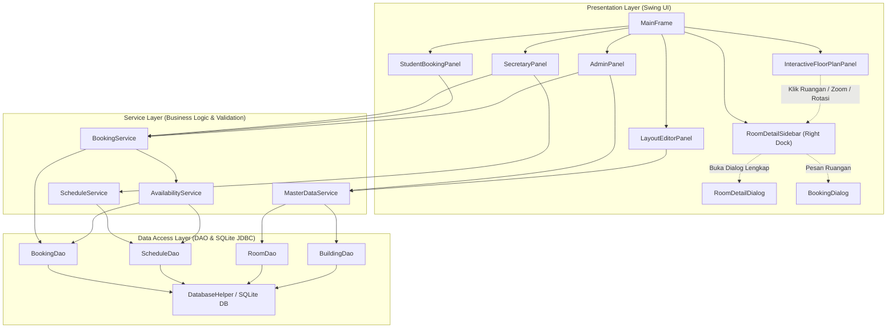

# Blueprint & Rencana Aksi Revisi Sistem CampusRoom

> **Status Dokumen**: Disetujui untuk Implementasi  
> **Target Aplikasi**: CampusRoom Desktop Application (Java Swing, SQLite, Layered Architecture)  
> **Audiens Target**: AI Engineering Agents & Pengembang Sistem  
> **Lokasi Rencana**: `rencana_revisi/`  

---

## 📌 1. Ringkasan Eksekutif (Executive Summary)

Dokumen ini disusun sebagai panduan teknis operasional dan arsitektural untuk melaksanakan 10 butir revisi dan penyempurnaan pada aplikasi desktop **CampusRoom**. Seluruh instruksi dan spesifikasi teknis telah distrukturkan sedemikian rupa menggunakan terminologi baku rekayasa perangkat lunak agar dapat dipahami dan dieksekusi secara presisi oleh **AI Agent** maupun pengembang manusia.

### Matriks 10 Butir Revisi

| No | Modul Revisi | Cakupan / Layer | File Utama Terdampak | Prioritas | Kompleksitas |
|:--:|:---|:---|:---|:---:|:---:|
| **1** | [Rotasi Denah untuk Menyesuaikan POV Pengguna](01_rotasi_denah_pov.md) | UI Presentation (Graphics2D) | `InteractiveFloorPlanPanel.java`, `MainFrame.java` | Medium | Medium |
| **2** | [Detail Jadwal Mengajar per Dosen (Portal Sekre)](02_jadwal_per_dosen_sekre.md) | DAO, Service, UI | `ScheduleDao.java`, `ScheduleService.java`, `SecretaryPanel.java` | High | Medium |
| **3** | [Validasi Booking Maksimal H-1 & Kunci Data Fiks](03_validasi_booking_h1_dan_kunci_fiks.md) | Business Logic & UI Guard | `BookingService.java`, `BookingDialog.java`, `AdminPanel.java` | High | Low |
| **4** | [Sistem Pencarian Global & Filter Responsif](04_fitur_pencarian_global.md) | UI Filtering & Canvas Nav | `MainFrame.java`, `SecretaryPanel.java`, `AdminPanel.java` | High | Medium |
| **5** | [Persistensi State UI Saat Berpindah Menu Navigasi](05_persistensi_state_navigasi_menu.md) | State Management / UI | `MainFrame.java`, `InteractiveFloorPlanPanel.java` | High | Medium |
| **6** | [Rendering Teks Adaptif & Level-of-Detail Ruangan](06_rendering_teks_adaptif_ruangan.md) | UI Graphics Rendering | `InteractiveFloorPlanPanel.java` | Medium | Low |
| **7** | [Detail Jadwal Lengkap Terpadu di Dialog Ruangan](07_detail_jadwal_lengkap_per_ruang.md) | DAO, Service, Dialog UI | `RoomDetailDialog.java`, `ScheduleDao.java`, `BookingDao.java` | Medium | Medium |
| **8** | [Integrasi Tombol & Dialog WhatsApp Resmi Admin](08_integrasi_kontak_wa_admin.md) | UI Interaction & Desktop API | `MainFrame.java`, `StudentBookingPanel.java`, `ModernUIHelper.java` | Low | Low |
| **9** | [Penyempurnaan UX & Alur Interaktif Edit Ruangan](09_perbaikan_ux_edit_ruangan.md) | UI Workflow & Validation | `AdminPanel.java`, `LayoutEditorPanel.java`, `RoomInspectorDialog.java` | High | Medium |
| **10** | [Sidebar Inspector Kanan dengan Jadwal Scrollable](10_sidebar_kanan_scrollable_jadwal.md) | UI Presentation & Layout | `MainFrame.java`, `ScheduleService.java` | High | Medium |

---

## 🏛️ 2. Arsitektur Komponen & Alur Interaksi Sistem

Arsitektur aplikasi CampusRoom mengadopsi pola **Layered Architecture** (Presentation, Service, Data Access, Model). Seluruh perubahan wajib menghormati pemisahan tanggung jawab (*Separation of Concerns*) ini.

---

## 📂 3. Daftar Berkas Spesifikasi Teknis Rinci

Setiap butir revisi memiliki berkas spesifikasi teknis mandiri yang menguraikan konteks masalah, perubahan kode per berkas, acceptance criteria, dan skenario pengujian:

1. [**01_rotasi_denah_pov.md**](01_rotasi_denah_pov.md) — Penambahan variabel rotasi (0°, 90°, 180°, 270°), matriks transformasi Graphics2D, pemetaan invers koordinat mouse, dan tombol POV di ribbon toolbar.
2. [**02_jadwal_per_dosen_sekre.md**](02_jadwal_per_dosen_sekre.md) — Penambahan tab/sub-panel jadwal per dosen pada SecretaryPanel, query DAO pengelompokan pengajar, ringkasan beban SKS, dan tabel jadwal mengajar terpadu.
3. [**03_validasi_booking_h1_dan_kunci_fiks.md**](03_validasi_booking_h1_dan_kunci_fiks.md) — Aturan bisnis pengajuan minimal H-1 sebelum tanggal perkuliahan, error feedback terpadu, dan proteksi read-only bagi jadwal dan booking yang sudah berstatus resmi `DISETUJUI`.
4. [**04_fitur_pencarian_global.md**](04_fitur_pencarian_global.md) — Penambahan search bar pada denah interaktif (quick highlight & focus), implementasi `TableRowSorter` responsif pada seluruh tabel (Sekretaris, Mahasiswa, Admin).
5. [**05_persistensi_state_navigasi_menu.md**](05_persistensi_state_navigasi_menu.md) — Retensi state UI ketika berpindah tab pada `CardLayout` (pertahankan pilihan dropdown gedung/lantai, riwayat pencarian, seleksi ruangan aktif, dan posisi scroll tabel).
6. [**06_rendering_teks_adaptif_ruangan.md**](06_rendering_teks_adaptif_ruangan.md) — Level of Detail (LOD) rendering kotak denah: mode Compact (hanya kode ruang & dot), mode Medium (kode & nama), dan mode Full (lengkap dengan kapasitas, tipe, dan badge status).
7. [**07_detail_jadwal_lengkap_per_ruang.md**](07_detail_jadwal_lengkap_per_ruang.md) — Peningkatan dialog detail ruangan agar menyajikan tabel komprehensif jadwal kuliah reguler mingguan dan permohonan kelas pengganti yang aktif di ruangan tersebut.
8. [**08_integrasi_kontak_wa_admin.md**](08_integrasi_kontak_wa_admin.md) — Penyediaan tombol hubungi admin via WhatsApp resmi (`081399887766`) di header/footer, dialog popup informasi layanan, dan link protokol `https://wa.me/` via Desktop API.
9. [**09_perbaikan_ux_edit_ruangan.md**](09_perbaikan_ux_edit_ruangan.md) — Penambahan tombol eksplisit "Edit Ruangan" di master data admin, double-click trigger, banner panduan interaksi visual di Layout Editor, dan penyederhanaan label koordinat.
10. [**10_sidebar_kanan_scrollable_jadwal.md**](10_sidebar_kanan_scrollable_jadwal.md) — Perombakan dock inspector kanan pada `MainFrame` dengan menambahkan kontainer scrollable berisi daftar kartu jadwal sesi perkuliahan aktif untuk ruangan yang diklik.
11. [**PANDUAN_EKSEKUSI_AI_AGENT.md**](PANDUAN_EKSEKUSI_AI_AGENT.md) — Panduan urutan pengerjaan fase demi fase (Fase 1 hingga Fase 4), aturan dependensi, quality gates, dan instruksi verifikasi otomatis.

---

## 🚀 4. Prinsip Kerja & Panduan Bagi AI Agent

Saat mengeksekusi rencana ini, AI Agent wajib mematuhi panduan teknis berikut:
- **Zero Regression**: Kode yang telah berjalan baik dan seluruh unit test eksisting (`BookingServiceTest`, `ScheduleServiceTest`, `SidebarNavigationTest`, dsb.) tidak boleh rusak setelah revisi diterapkan.
- **Batched Execution**: Lakukan pembaruan kode secara modular dan berurutan sesuai fase di `PANDUAN_EKSEKUSI_AI_AGENT.md`.
- **Swing Thread Safety**: Semua mutasi komponen UI wajib dijalankan di dalam *Event Dispatch Thread* (EDT) menggunakan `SwingUtilities.invokeLater(...)` jika dipicu oleh thread asinkron.
- **Clean Architecture Enforcement**: Komponen antarmuka pengguna (`com.campusroom.ui`) tidak boleh mengakses `DatabaseHelper` atau SQL secara langsung; selalu gunakan layer `com.campusroom.service` dan model `com.campusroom.model`.
